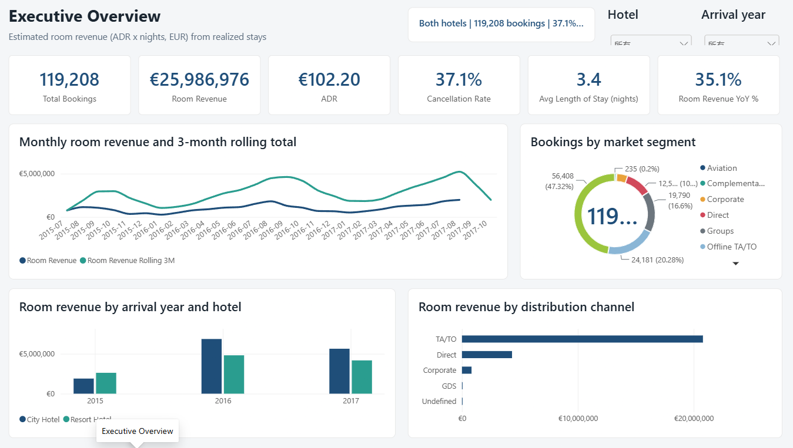
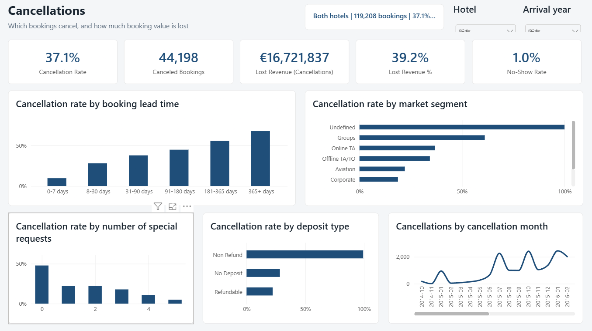
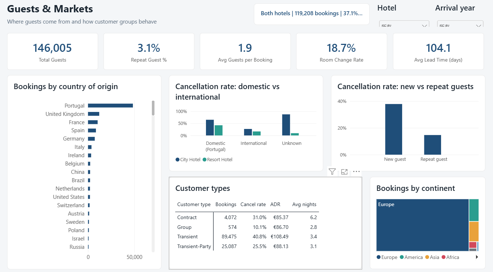
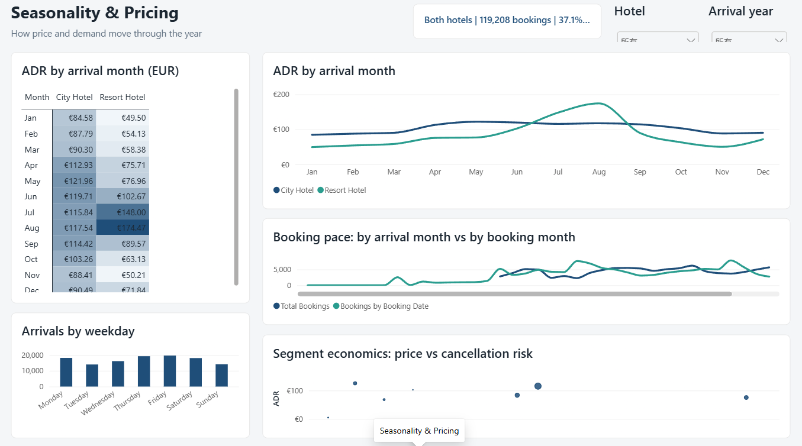

# Hotel Booking Demand: Power BI Analysis

An end-to-end Power BI project on **119,208 hotel bookings** (two hotels in Portugal, July 2015 to
August 2017): Python ETL into a star schema, a DAX measure layer with time intelligence, and a
four-page interactive report on revenue, cancellations, guest markets and seasonal pricing.

**Tools:** Power BI Desktop (PBIP project: TMDL model + PBIR report), DAX, Power Query (M), Python (pandas)



## Business questions

1. How much room revenue do the two hotels make, and how is it trending?
2. How large is the cancellation problem, and which bookings are most likely to cancel?
3. Where do guests come from, and how do different customer groups behave?
4. How do prices (ADR) move across the year, and how does that differ between a city and a resort hotel?

## Key findings

| Metric | City Hotel | Resort Hotel | Total |
| --- | --- | --- | --- |
| Bookings | 79,162 | 40,046 | 119,208 |
| Cancellation rate | 41.8% | 27.8% | 37.1% |
| ADR (EUR, realized stays) | 106.98 | 96.83 | 102.20 |
| Avg length of stay (nights) | 2.9 | 4.1 | 3.4 |
| Avg lead time (days) | 110 | 93 | 104 |

- **Cancellations are the biggest lever.** 37% of bookings were canceled, representing about
  **EUR 16.7M of booking value** against EUR 26.0M realized room revenue.
- **Lead time predicts cancellation.** Bookings made within a week cancel 9.6% of the time;
  bookings made more than a year ahead cancel 67.7% of the time.
- **Engaged guests stay.** Guests with no special requests cancel 47.8% of the time; one request
  drops that to 22.0%. Repeat guests cancel 14.7% vs 37.8% for first-time guests.
- **Groups and online travel agents are the riskiest segments** (61.1% and 36.8% cancellation),
  while Direct (15.4%) and Corporate (18.8%) bookings are the most reliable.
- **The resort hotel is highly seasonal.** Resort ADR goes from about EUR 50 in January to
  EUR 175 in August, while City Hotel ADR stays in a EUR 85-122 band and peaks in May.
- **Growth.** Over the months that have data in both years (Jul 2016-Aug 2017 vs Jul 2015-Aug 2016),
  room revenue grew 35.1%. On a trailing-12-month basis (Sep 2016-Aug 2017) it grew 27.8%, with
  ADR up 13.0%, so roughly half of the growth came from price.

**Recommendations** (from the data, for discussion): tighten deposit or reconfirmation rules for
long-lead and group bookings; push direct bookings over OTA channels; use pre-arrival engagement
(special-request prompts) as a cheap retention tool; price the resort more aggressively in the
shoulder months.

All numbers can be reproduced with `python etl/key_findings.py`.

## Report pages

| Page | What it shows |
| --- | --- |
| Executive Overview | KPI cards, monthly revenue with a rolling 3-month total, revenue by year and hotel, distribution channels, segment mix, YoY on comparable months |
| Cancellations | Cancellation rate by lead time, market segment, deposit type and special requests; lost revenue; cancellations by cancellation month |
| Guests & Markets | Bookings by country and continent, domestic vs international and new vs repeat cancellation rates, customer-type matrix |
| Seasonality & Pricing | ADR heatmap by month and hotel, ADR curve, booking pace (booking vs arrival month), arrivals by weekday, segment price vs risk scatter |

Every page has Hotel and Arrival-year slicers and a dynamic subtitle measure
(`Both hotels | 119,208 bookings | 37.1% canceled`).

| | |
| --- | --- |
|  |  |
|  | |

## Data model

A star schema with one fact table and eight dimensions.

```
                    dim_hotel   dim_country   dim_meal
                         \          |          /
 dim_market_segment ---- fact_bookings ---- dim_customer_type
 dim_distribution_channel /    |    \ dim_deposit_type
                               |
                            dim_date
          (arrival_date: active; booking_date, status_date: inactive)
```

- `dim_date` is a marked date table. Arrival date is the active relationship; booking date and
  cancellation date use inactive relationships switched on with `USERELATIONSHIP`, so the same
  calendar can show booking pace and cancellation timing.
- Full column descriptions: [docs/DATA_DICTIONARY.md](docs/DATA_DICTIONARY.md).

## DAX highlights

All measures are in [powerbi/measures.dax](powerbi/measures.dax). A few worth noting:

```dax
-- Weighted ADR: revenue / room nights, not a plain average of the adr column
ADR = DIVIDE ( [Room Revenue], [Room Nights] )

-- Bookings counted by booking date instead of arrival date
Bookings by Booking Date =
CALCULATE ( [Total Bookings], USERELATIONSHIP ( fact_bookings[booking_date], dim_date[date] ) )

-- YoY only over months that have data in both years (the data starts mid-2015 and ends mid-2017)
Room Revenue PY (Comparable) =
VAR FirstData = CALCULATE ( MIN ( fact_bookings[arrival_date] ), REMOVEFILTERS ( fact_bookings ) )
VAR LastData  = CALCULATE ( MAX ( fact_bookings[arrival_date] ), REMOVEFILTERS ( fact_bookings ) )
VAR Periods =
    FILTER ( VALUES ( dim_date[date] ),
             dim_date[date] >= EDATE ( FirstData, 12 ) && dim_date[date] <= LastData )
RETURN CALCULATE ( [Room Revenue], SAMEPERIODLASTYEAR ( Periods ) )
```

## Report as code

The report is saved as a **Power BI Project (PBIP)**, so the model and every visual are plain text
that Git can diff:

- `Hotel_Booking_Analysis.SemanticModel/` - the model in TMDL: tables with Power Query (M) partitions,
  relationships, the date table, sort orders and all 29 measures.
- `Hotel_Booking_Analysis.Report/` - the report in PBIR: one JSON file per page and per visual,
  plus the custom theme.
- `tools/generate_pbip.py` generates both from the model CSVs and `powerbi/measures.dax`, so layout and
  measure changes are made in code and reviewed like any other change.

## Data preparation

`etl/build_model.py` turns the raw file into the model tables and validates them
(unique keys, every foreign key present in its dimension, every date inside `dim_date`).
See [data/model/CLEANING_LOG.md](data/model/CLEANING_LOG.md).

- Removed 180 bookings with zero guests and 2 bookings with impossible ADR (negative or above EUR 1,000).
- Filled missing `children` with 0 and missing country with `UNK`; fixed the non-standard codes
  `CN` -> `CHN` and `TMP` -> `TLS`; merged meal `Undefined` into `SC` (no meal), as the dataset authors describe.
- Built real dates from the year/month/day columns and derived the booking date (arrival - lead time).
- Added country names, continents and UN regions; lead-time buckets; a room-change flag; and
  `booking_value = ADR x nights`.

**Caveats.** Revenue is estimated from ADR x nights, since the data has no billed amounts.
Calendar years 2015 and 2017 are partial. Almost all non-refundable bookings are marked canceled in
the source data, and canceled domestic bookings may carry a default country, so those two findings
are indicative rather than causal. More in the data dictionary.

## Repository structure

```
.
├── data/
│   ├── raw/hotel_bookings.csv        source data
│   └── model/                        star-schema CSVs loaded by Power BI + cleaning log
├── etl/
│   ├── build_model.py                cleaning, star schema, validation
│   └── key_findings.py               reproduces the numbers in this README
├── Hotel_Booking_Analysis.pbip       open this in Power BI Desktop
├── Hotel_Booking_Analysis.SemanticModel/   model (TMDL)
├── Hotel_Booking_Analysis.Report/          report pages and visuals (PBIR)
├── tools/
│   └── generate_pbip.py              builds the PBIP model and report from code
├── powerbi/
│   ├── measures.dax                  all DAX measures (source for the model)
│   └── theme.json                    report theme
└── docs/
    ├── DATA_DICTIONARY.md
    ├── REPORT_BUILD_GUIDE.md         how the report was built, page by page
    └── screenshots/
```

## Run it

```bash
pip install -r requirements.txt
python etl/build_model.py     # rebuilds data/model/*.csv
python etl/key_findings.py    # prints the headline numbers
```

Then open `Hotel_Booking_Analysis.pbip` in Power BI Desktop (a recent version; PBIP/PBIR support
is needed). The CSV folder is a parameter: go to **Transform data > Edit parameters**, set
`DataFolder` to the full path of `data/model/` on your machine (ending in `\`), and click **Refresh**.

To regenerate the model and report after changing measures or layout:

```bash
python tools/generate_pbip.py --data-folder "C:\path\to\repo\data\model\"
```

## Data source and usage

- **Original dataset:** Nuno Antonio, Ana de Almeida, Luis Nunes (2019). *Hotel booking demand datasets.*
  Data in Brief, 22, 41-49. [doi:10.1016/j.dib.2018.11.126](https://doi.org/10.1016/j.dib.2018.11.126).
  The data was anonymised by its authors.
- **Where this copy came from:** the course materials of the Udemy course *Python for Machine Learning &
  Data Science Masterclass* (Pierian Data), which redistribute the dataset with added synthetic name,
  e-mail, phone and card columns. Those synthetic columns are removed here and are not part of this
  repository.
- **Non-commercial use only.** This project and its data are shared for learning and portfolio purposes.
  The data is not covered by this repository's code licence; do not use it commercially. For any other
  use, go to the original publication above and follow its terms.

## License

The code (`etl/`, `tools/`, DAX measures and report definition) is released under the [MIT License](LICENSE).
The data in `data/` is excluded from that licence; see *Data source and usage* above.

